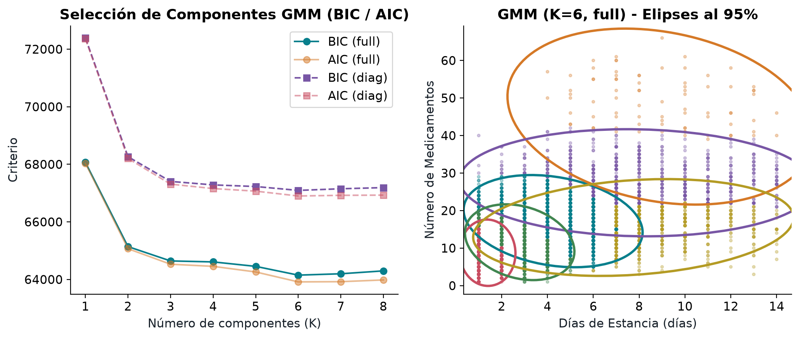
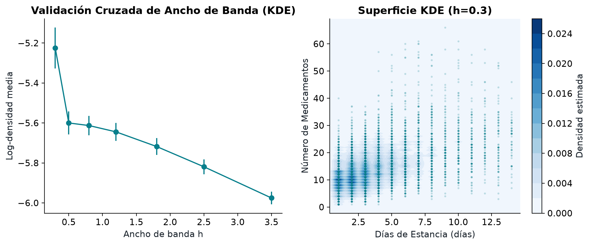
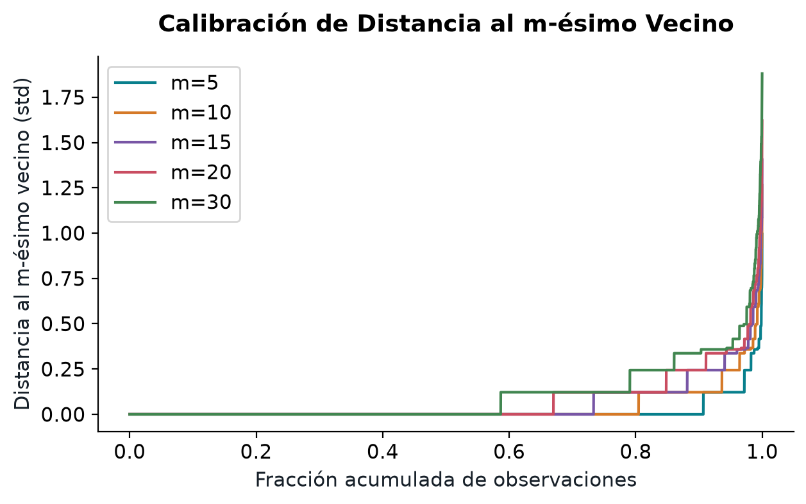
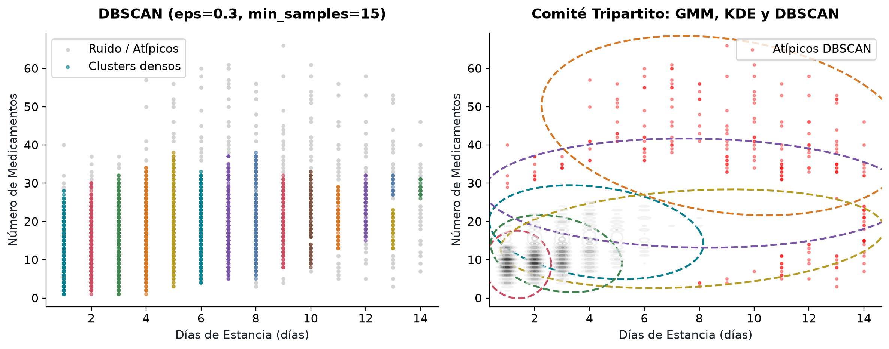

# Documento Técnico: Análisis No Supervisado de Atenciones Hospitalarias en Diabetes
**Modelos Evaluados: GMM, KDE y DBSCAN**  
*Machine Learning II — Parcial 2*

---

## 1. Auditoría y Preprocesamiento de Datos

### Unidad de Análisis
El dataset original proviene de 130 centros hospitalarios de Estados Unidos e incluye 101.766 atenciones registradas entre 1999 y 2008. Para garantizar la independencia de las observaciones y evitar sesgos de autocorrelación provocados por reingresos recurrentes de un mismo paciente, se aplicó un filtro estricto conservando únicamente la primera atención registrada por cada paciente único.

Esta auditoría redujo el volumen a 71.518 observaciones. Sobre este conjunto se definió una partición reproducible del 80% para desarrollo (57.214 registros) y 20% para evaluación en test independiente (14.304 registros). Con fines de viabilidad computacional y estabilidad visual en la rejilla de densidad, se extrajo una muestra de trabajo representativa de 6.000 pacientes para la fase de ajuste de modelos.

### Espacio de Representación y Escalado
Se trabajó en el plano bidimensional definido por:
- `time_in_hospital`: Días transcurridos desde el ingreso hasta el alta (rango: 1 a 14 días).
- `num_medications`: Cantidad de medicamentos distintos administrados durante la estancia (rango: 1 a 81 fármacos).

Para la estimación de densidad no paramétrica (KDE) y los modelos de mezclas gaussianas (GMM), las variables mantuvieron su escala natural para preservar la interpretación física de las unidades. Para DBSCAN se aplicó estandarización z-score (`StandardScaler`), dado que la mayor varianza observada en el conteo de medicamentos habría distorsionado el cálculo de la distancia euclidiana $\varepsilon$.

---

## 2. Evaluación Cuantitativa de los Modelos

### Gaussian Mixture Models (GMM)
Se evaluaron estructuras de covarianza (`full`, `diag`, `tied`, `spherical`) y un rango de componentes $K \in [1, 8]$.

| Componentes ($K$) | Estructura de Covarianza | BIC | AIC | Coeficiente de Silueta |
| :---: | :---: | :---: | :---: | :---: |
| 6 | Full | 64.149,86 | 63.915,37 | 0,1683 |
| 7 | Full | 64.197,15 | 63.922,47 | 0,1934 |
| 8 | Full | 64.297,50 | 63.982,62 | 0,1778 |
| 5 | Full | 64.454,43 | 64.260,15 | 0,1506 |
| 6 | Tied | 65.511,86 | 65.377,87 | 0,4190 |
| 6 | Diag | 67.093,94 | 66.899,65 | 0,2051 |

**Selección final**: GMM con $K=6$ y covarianza `full`. La estructura covarianza completa permite capturar la inclinación diagonal (correlación positiva entre mayor estancia y más fármacos).

{width=90%}

### Kernel Density Estimation (KDE)
Se aplicó validación cruzada de 3 pliegues explorando anchos de banda $h \in [0,2; 2,5]$ y kernels (`gaussian`, `tophat`).

| Kernel | Ancho de Banda ($h$) | Log-Densidad Media (CV) | Desviación Estándar |
| :--- | :---: | :---: | :---: |
| Gaussian | 0,2 | -4,8019 | 0,1733 |
| Gaussian | 0,3 | -5,2245 | 0,0835 |
| Gaussian | 0,5 | -5,5999 | 0,0469 |
| Gaussian | 1,2 | -5,6446 | 0,0370 |
| Tophat | 0,2 – 2,5 | -inf (descartado) | - |

**Selección final**: Kernel `gaussian` con $h=0,2$. Un ancho de banda menor a 0.2 sobreajusta la superficie, mientras que valores superiores a 0.5 diluyen los núcleos multimodales.

{width=90%}

### DBSCAN y Sensibilidad de Parámetros
Se evaluaron 30 combinaciones sobre los datos estandarizados para seleccionar el radio $\varepsilon$ y el tamaño mínimo de vecindad `min_samples`.

| $\varepsilon$ (Estandarizado) | `min_samples` | Clusters Detectados | % Ruido / Atípicos | Silueta (sin ruido) |
| :---: | :---: | :---: | :---: | :---: |
| 0,3 | 15 | 15 | 3,75% | 0,0814 |
| 0,3 | 20 | 15 | 5,77% | 0,0901 |
| 0,3 | 10 | 17 | 2,50% | 0,0677 |
| 0,4 | 10 | 2 | 0,78% | 0,6482 |
| 0,5 | 10 | 2 | 0,33% | 0,6505 |

**Selección final**: $\varepsilon=0,3$ y `min_samples=15`. Permite separar el núcleo denso en componentes y aislar un 3,75% de datos de baja densidad (ruido).

{width=70%}

---

## 3. Perfiles de Pacientes y Tipo de Atención

Los modelos permiten agrupar la población según la intensidad de la atención y la severidad del episodio:

### Perfil 1: Atención Aguda y Estabilización Rápida
- **Características**: Estancias cortas (1 a 3 días) y bajo número de medicamentos (1 a 12 fármacos). Representa el 28,60% de la población.
- **Tipo de paciente**: Personas que ingresan por descompensaciones glucémicas puntuales o ajustes menores en la dosis de insulina.
- **Atención requerida**: Alta rotación, protocolo de alta rápida y derivación a control ambulatorio.
- **Comportamiento en los modelos**: Identificado como el núcleo de mayor masa de probabilidad en KDE y el cluster principal en DBSCAN.

### Perfil 2: Hospitalización de Complejidad Intermedia
- **Características**: Estancias de 4 a 7 días y consumo de 13 a 25 medicamentos. Representa el 21,17% de las atenciones.
- **Tipo de paciente**: Pacientes con comorbilidades (hipertensión, infecciones moderadas) que requieren estabilización multidisciplinaria.
- **Atención requerida**: Monitoreo continuo de laboratorio y esquemas farmacológicos combinados.
- **Comportamiento en los modelos**: Representado por las componentes gaussianas intermedias en GMM, mostrando el solapamiento progresivo con el perfil agudo.

### Perfil 3: Pacientes Crónicos Complejos y Polifarmacia Extrema
- **Características**: Estancias superiores a 8 días y más de 25 medicamentos administrados. Representa el 4,75% del total.
- **Tipo de paciente**: Casos graves, ancianos o pacientes con fallas en múltiples órganos (renal, cardiovascular).
- **Atención requerida**: Cuidados intermedios, supervisión de farmacovigilancia para prevenir interacciones adversas y seguimiento post-alta.
- **Comportamiento en los modelos**: Detectado como **ruido (etiqueta -1)** en DBSCAN debido a la baja densidad espacial de estos registros.

---

## 4. Matriz de Comparación y Aplicabilidad

| Criterio | GMM (Mezclas Gaussianas) | KDE (Estimación de Densidad) | DBSCAN (Basado en Densidad) |
| :--- | :--- | :--- | :--- |
| **Forma de los grupos** | Elíptica con contornos al 95% | Continua (sin formas rígidas) | Arbitraria basada en densidad local |
| **Manejo de atípicos** | Asigna probabilidades a todos | Suaviza atípicos en colas de densidad | Aísla atípicos como ruido (-1) |
| **Interpretación clínica** | Perfiles con media y varianza | Mapas topográficos de masa | Núcleos de atención vs casos raros |
| **Mejor escenario de uso** | Modelar poblaciones superpuestas | Visualizar gradientes asistenciales | Detectar casos de alto costo/riesgo |

{width=95%}

---

## 5. Evaluación en Datos de Prueba e Inferencia Final

Al evaluar los modelos ajustados sobre el conjunto de test congelado (independiente), se obtuvieron los siguientes resultados:

- **GMM**: Log-likelihood media en test de **-5,6124**, manteniendo estabilidad con la muestra de desarrollo.
- **KDE**: Log-densidad media en test de **-4,8150**, confirmando la solidez en la estimación de la masa continua.

### Conclusión Principal
El análisis no supervisado demuestra que las hospitalizaciones por diabetes no se dividen en grupos aislados o rígidos, sino en una estructura continua con un núcleo denso de atención rápida y una cola pesada de casos atípicos. DBSCAN es el modelo más efectivo para identificar pacientes de alto riesgo (polifarmacia y larga estancia), mientras que GMM y KDE permiten planificar la capacidad hospitalaria general.
